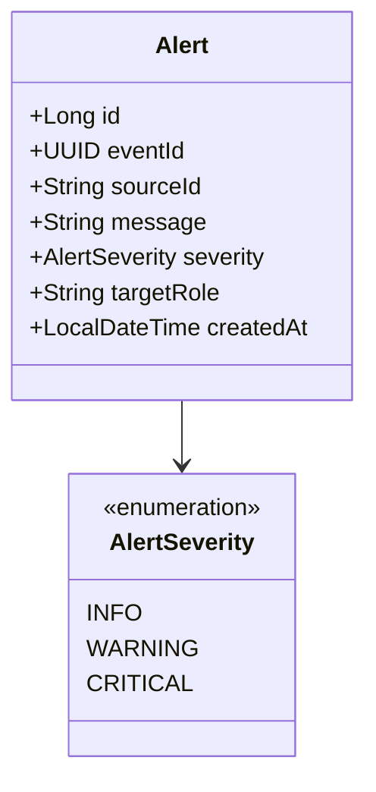
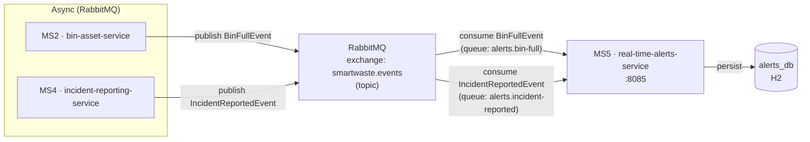
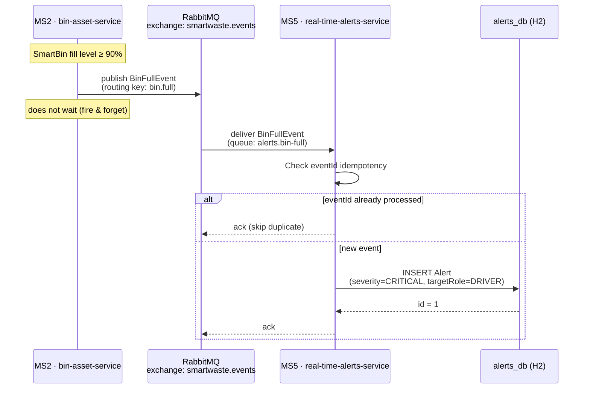
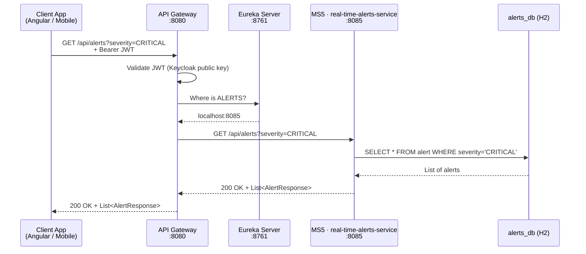

# Real-Time Alerts Service (MS5) — Design Document

> **Owner:** Amen Bahri  
> **Service:** `real-time-alerts-service`  
> **Port:** 8085  
> **Database:** H2 in-memory (`alerts_db`)  
> **Eureka name:** ALERTS  
> **Base path:** `/api/alerts`

---

## 1. Responsibilities

The **Real-Time Alerts Service** is the notification engine of the SmartWaste platform. Its bounded context covers:

- **Receiving critical events** from other microservices via RabbitMQ (asynchronous).
- **Creating and persisting alerts** based on those events (e.g., bin overflow, new incident reported).
- **Exposing a REST API** to query, acknowledge, and manage alerts.
- **Idempotent processing**: duplicate messages with the same `eventId` are silently ignored.

This service does **not** own bins, users, trucks, or incidents — it only reacts to events published by their respective owners.

---

## 2. Data Model — Class Diagram



| Field        | Type              | Description                                                        |
|--------------|-------------------|--------------------------------------------------------------------|
| `id`         | `Long`            | Auto-generated primary key                                         |
| `eventId`    | `UUID`            | Idempotency key — unique per event, prevents duplicate processing  |
| `sourceId`   | `String`          | ID of the source object (binId, reportId, etc.)                    |
| `message`    | `String`          | Human-readable alert message                                       |
| `severity`   | `AlertSeverity`   | `INFO`, `WARNING`, or `CRITICAL`                                   |
| `targetRole` | `String`          | Role that should receive this alert (e.g., `OPERATOR`, `DRIVER`)   |
| `createdAt`  | `LocalDateTime`   | Timestamp when the alert was created                               |

### Database Choice: H2 (In-Memory)

- **Justification:** For Validation 1, H2 allows the app to start cleanly without requiring an external database server. In production, this would be migrated to PostgreSQL or another persistent store.
- **DDL strategy:** `spring.jpa.hibernate.ddl-auto=update` — Hibernate auto-creates the schema.
- **H2 Console:** accessible at `/h2-console` for development inspection.

---

## 3. Interactions with Other Microservices

### 3.1 Overview



### 3.2 Asynchronous Communication (RabbitMQ)

The real-time-alerts-service is a **consumer only**. It subscribes to two events via RabbitMQ:

#### Event 1: `BinFullEvent`

| Property     | Type      | Description                            |
|--------------|-----------|----------------------------------------|
| `eventId`    | `UUID`    | Unique event identifier (idempotency)  |
| `binId`      | `String`  | ID of the bin that reached threshold   |
| `fillLevel`  | `Double`  | Current fill level (e.g., 0.95 = 95%)  |
| `timestamp`  | `Instant` | When the event occurred                |

- **Producer:** `bin-asset-service` (MS2)
- **Exchange:** `smartwaste.events` (topic, durable)
- **Routing key:** `bin.full`
- **Queue:** `alerts.bin-full`
- **Trigger:** When a smart bin's fill level exceeds the configured threshold (e.g., ≥ 90%).
- **Alert created:** severity = `CRITICAL`, targetRole = `DRIVER`, message = "Bin {binId} is full ({fillLevel}%)"

#### Event 2: `IncidentReportedEvent`

| Property     | Type      | Description                          |
|--------------|-----------|--------------------------------------|
| `eventId`    | `UUID`    | Unique event identifier              |
| `reportId`   | `String`  | ID of the incident report            |
| `title`      | `String`  | Title of the incident                |
| `binId`      | `String`  | Related bin (if any)                 |
| `timestamp`  | `Instant` | When the incident was reported       |

- **Producer:** `incident-reporting-service` (MS4)
- **Exchange:** `smartwaste.events` (topic, durable)
- **Routing key:** `incident.reported`
- **Queue:** `alerts.incident-reported`
- **Trigger:** When a citizen or operator submits an incident report.
- **Alert created:** severity = `WARNING`, targetRole = `OPERATOR`, message = "New incident reported: {title}"

### 3.3 Synchronous Communication

The real-time-alerts-service does **not** make any synchronous (OpenFeign) calls to other services for Validation 1. All data needed to create an alert is carried within the RabbitMQ event payload itself.

> **Note:** In a future iteration, the service could call `identity-service` via OpenFeign to resolve user notification preferences (e.g., email, SMS). This would be a **synchronous** call: `GET /api/users/{userId}`.

### 3.4 Failure Scenarios

| Scenario                              | Behavior                                                                 |
|---------------------------------------|--------------------------------------------------------------------------|
| RabbitMQ is down                      | Messages queue up in the broker; alerts-service processes them on reconnect |
| Duplicate `eventId` received          | Silently ignored — no duplicate alert created (idempotent consumer)      |
| bin-asset-service is down             | No impact — alerts-service does not call it synchronously                |
| incident-reporting-service is down    | No impact — alerts-service does not call it synchronously                |
| alerts-service is down                | Messages accumulate in their queues; processed when the service restarts |

---

## 4. REST API Contracts

**Base path:** `/api/alerts`

### 4.1 Endpoints

| Method   | URI                      | Description                          | Request Body        | Response              | Codes                        |
|----------|--------------------------|--------------------------------------|---------------------|-----------------------|------------------------------|
| `GET`    | `/api/alerts`            | List all alerts (with optional filters) | —                | `List<AlertResponse>` | `200 OK`                     |
| `GET`    | `/api/alerts/{id}`       | Get a single alert by ID             | —                   | `AlertResponse`       | `200 OK`, `404 Not Found`    |
| `GET`    | `/api/alerts/severity/{severity}` | List alerts by severity     | —                   | `List<AlertResponse>` | `200 OK`                     |
| `DELETE` | `/api/alerts/{id}`       | Delete / acknowledge an alert        | —                   | —                     | `204 No Content`, `404 Not Found` |

### 4.2 Response DTO — `AlertResponse`

```json
{
  "id": 1,
  "eventId": "7b1e3f4a-...",
  "sourceId": "bin-042",
  "message": "Bin bin-042 is full (95%)",
  "severity": "CRITICAL",
  "targetRole": "DRIVER",
  "createdAt": "2026-11-12T14:30:00"
}
```

### 4.3 HTTP Status Codes

| Code  | Meaning                                    |
|-------|--------------------------------------------|
| `200` | Success — resource(s) returned             |
| `204` | Alert successfully deleted / acknowledged  |
| `404` | Alert with the given ID not found          |
| `500` | Internal server error                      |

### 4.4 Events Consumed (not REST — async via RabbitMQ)

| Event                    | Routing Key          | Queue                       | Action                                |
|--------------------------|----------------------|-----------------------------|---------------------------------------|
| `BinFullEvent`           | `bin.full`           | `alerts.bin-full`           | Creates a CRITICAL alert for drivers  |
| `IncidentReportedEvent`  | `incident.reported`  | `alerts.incident-reported`  | Creates a WARNING alert for operators |

---

## 5. Sequence Diagram — Consuming a BinFullEvent



---

## 6. Sequence Diagram — Querying Alerts via REST


