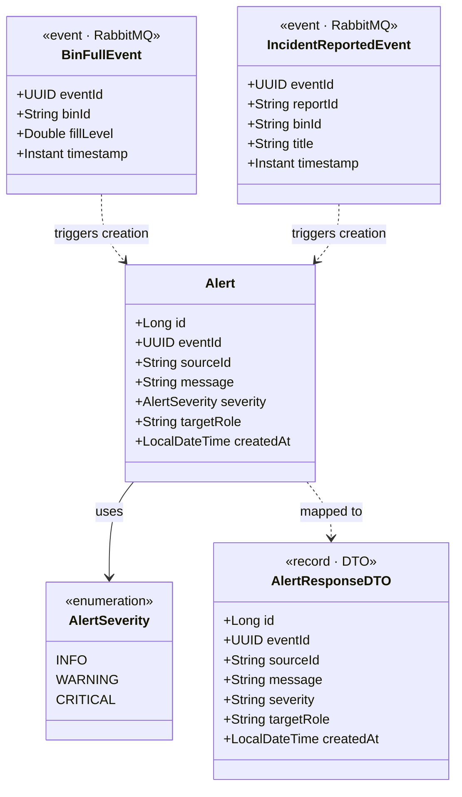
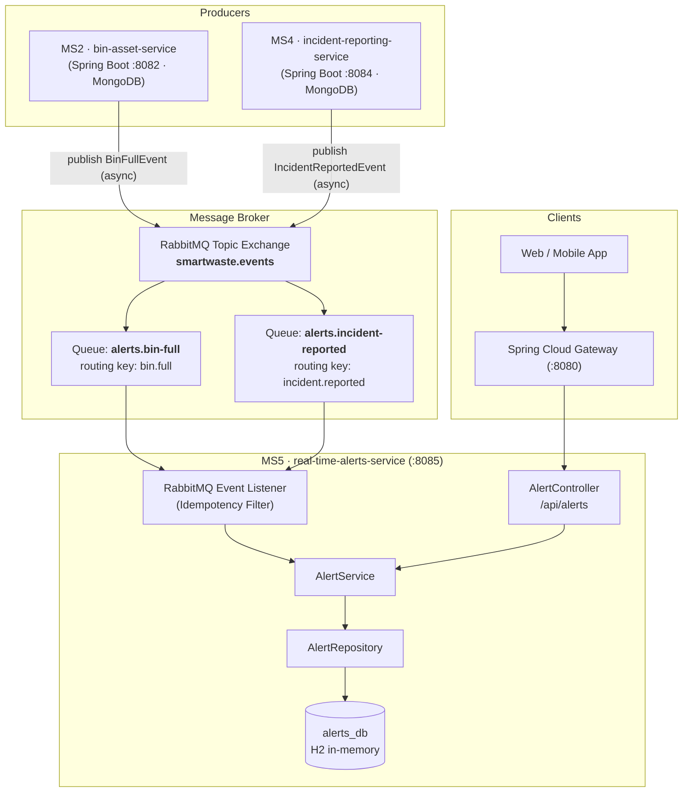

# Real-Time Alerts Service (MS5) — Technical Specification & Design

> **Service:** `real-time-alerts-service`  
> **Module:** AWD (Architecture Web Distribuée) - ESPRIT  
> **Project:** Smart City Waste & Recycling Manager (SmartWaste)  
> **Student / Owner:** Amen Bahri (`AmenBahrii`)  
> **Port:** `8085`  
> **Database:** H2 In-Memory (`alerts_db`)  
> **Service Discovery Name (Eureka):** `ALERTS`  
> **Base API Path:** `/api/alerts`  

---

## 1. Bounded Context & Responsibilities (Criterion I1)

The **Real-Time Alerts Service (MS5)** encapsulates the alert and notification lifecycle within the Smart City Waste management domain.

### Core Responsibilities
1. **Event Ingestion (Asynchronous Consumer):** Consumes domain events produced by other microservices over RabbitMQ (e.g. `BinFullEvent` from `bin-asset-service`, `IncidentReportedEvent` from `incident-reporting-service`).
2. **Alert Generation & Classification:** Evaluates incoming event data, assigns severity levels (`INFO`, `WARNING`, `CRITICAL`), and determines the target recipient role (`OPERATOR`, `DRIVER`, `CITIZEN`).
3. **Idempotent Persistence:** Stores alerts in `alerts_db` (H2 in-memory). Enforces strict idempotency using the event's unique `eventId` (`UUID`), preventing duplicated alerts if messages are redelivered.
4. **REST API for Alert Consumption:** Exposes endpoints for client applications (mobile, dashboard) to query active alerts, filter by severity, and acknowledge/dismiss alerts.

### Boundary Clarification
- **Does NOT manage bin sensors or hardware:** Bins and sensor telemetry belong exclusively to `bin-asset-service` (MS2).
- **Does NOT manage truck routes:** Route planning belongs exclusively to `fleet-routing-service` (MS3).
- **Does NOT manage incident workflows:** Incident tickets belong exclusively to `incident-reporting-service` (MS4).
- **Does NOT store credentials:** User identities belong exclusively to `identity-service` (MS1).

---

## 2. Data Model & Class Diagram (Criterion I1)



### Entity Definition: `Alert`
- **`id`** (`Long`, Primary Key, auto-increment): Unique local alert identifier.
- **`eventId`** (`UUID`, Unique Index): Original event ID generated by the publisher; guarantees idempotency.
- **`sourceId`** (`String`): Identifier of the origin entity (e.g. `bin-101`, `incident-504`).
- **`message`** (`String`): Human-readable descriptive text.
- **`severity`** (`AlertSeverity` enum): `INFO`, `WARNING`, `CRITICAL`.
- **`targetRole`** (`String`): Intended audience (`DRIVER`, `OPERATOR`, `MUNICIPAL_ADMIN`).
- **`createdAt`** (`LocalDateTime`): Timestamp of alert creation.

### Database Justification: H2 (In-Memory)
- **Zero-Dependency Startup for Validation 1:** Embedded H2 ensures the application compiles, initializes tables via JPA/Hibernate (`spring.jpa.hibernate.ddl-auto=update`), and starts cleanly in under 8 seconds without requiring an active PostgreSQL or MongoDB daemon.
- **Fast Local Feedback & Inspection:** The H2 Web Console is enabled at `/h2-console` (`jdbc:h2:mem:alertsdb`).
- **Production Evolution:** The service can easily switch to PostgreSQL for production persistence by replacing the dependency and connection string in `application.properties`.

---

## 3. Microservice Interactions (Criterion I2)

### 3.1 Interaction Architecture Overview



### 3.2 Asynchronous Communication (RabbitMQ)

#### Why Asynchronous?
- **Decoupling & Non-blocking:** When a smart bin detects an overflow, `bin-asset-service` must not wait for notification delivery before recording the telemetry. Publishing an event is instantaneous ("fire-and-forget").
- **Broadcast / Pub-Sub:** A single `BinFullEvent` can be consumed independently by `real-time-alerts-service` (to notify operators/drivers) AND by `fleet-routing-service` (to dynamically re-route collection trucks).
- **High Availability & Fault Tolerance:** If `real-time-alerts-service` is temporarily stopped, RabbitMQ queues the messages safely. Upon restart, all backlog alerts are processed.

#### Event Schema 1: `BinFullEvent`
- **Exchange:** `smartwaste.events` (Topic Exchange)
- **Routing Key:** `bin.full`
- **Queue:** `alerts.bin-full`
- **Payload Example:**
```json
{
  "eventId": "9b1deb4d-3b7d-4bad-9bdd-2b0d7b3dcb6d",
  "binId": "BIN-TUNIS-042",
  "fillLevel": 0.94,
  "timestamp": "2026-11-12T20:15:00Z"
}
```
- **Reaction:** Generates an Alert with `severity = CRITICAL`, `targetRole = DRIVER`, `message = "SmartBin BIN-TUNIS-042 reached 94% capacity. Immediate collection required."`.

#### Event Schema 2: `IncidentReportedEvent`
- **Exchange:** `smartwaste.events` (Topic Exchange)
- **Routing Key:** `incident.reported`
- **Queue:** `alerts.incident-reported`
- **Payload Example:**
```json
{
  "eventId": "a4c2e68f-9a11-47c3-bb02-39218d6a8f10",
  "reportId": "INC-8812",
  "binId": "BIN-TUNIS-042",
  "title": "Vandalism / Broken lid",
  "timestamp": "2026-11-12T20:18:30Z"
}
```
- **Reaction:** Generates an Alert with `severity = WARNING`, `targetRole = OPERATOR`, `message = "Incident INC-8812 reported on bin BIN-TUNIS-042: Vandalism / Broken lid"`.

### 3.3 Synchronous Communication (OpenFeign)

#### Planned Synchronous Path (Optional / Future extension):
- **Target:** `identity-service` (MS1, port 8081).
- **Purpose:** Retrieve user contact preferences (email, phone, push token) for targeted dispatch.
- **Contract:** `GET /api/users/{id}` (via OpenFeign `UserClient`).
- **Resilience:** Circuit Breaker (Resilience4j) fallback: if `identity-service` is unavailable, fallback to default in-app alert broadcasting without blocking alert ingestion.

### 3.4 Failure & Resilience Scenarios (Criterion I2)

| Failure Scenario | Impact | System Reaction & Mitigation |
|------------------|--------|------------------------------|
| **RabbitMQ broker down** | Temporary loss of messaging pipeline | Service retries connection with exponential backoff. Producers retain unsent events or write to an Outbox table. |
| **Alerts Service crashes** | Down for maintenance or restart | RabbitMQ stores all incoming messages in durable queues (`durable=true`). When the service restarts, messages are consumed in FIFO order with zero data loss. |
| **Network partition / Duplicate delivery** | Duplicate message delivered | **Idempotent consumer:** The service checks if `eventId` already exists in `alerts_db`. If found, it acknowledges the message (`channel.basicAck`) and discards the duplicate. |
| **Corrupted / Invalid payload** | Parsing failure | Message rejected and forwarded to Dead Letter Exchange (`smartwaste.events.dlx`) for manual review, avoiding infinite crash loops. |

---

## 4. REST API Contracts (Criterion I1)

**Base URL:** `http://localhost:8080/api/alerts` (via API Gateway) or `http://localhost:8085/api/alerts` (direct)

### 4.1 Endpoints Specification

| HTTP Method | Endpoint URI | Description | Request Body | Success Code | Error Codes |
|-------------|--------------|-------------|--------------|--------------|-------------|
| `GET` | `/api/alerts` | List all active alerts (supports optional `?severity=` and `?role=` query params) | None | `200 OK` | `500 Internal Server Error` |
| `GET` | `/api/alerts/{id}` | Retrieve details of a specific alert by ID | None | `200 OK` | `404 Not Found`, `500 Internal Error` |
| `GET` | `/api/alerts/severity/{severity}` | Filter alerts by severity level (`INFO`, `WARNING`, `CRITICAL`) | None | `200 OK` | `400 Bad Request` (invalid enum) |
| `DELETE` | `/api/alerts/{id}` | Acknowledge / dismiss an alert | None | `204 No Content` | `404 Not Found`, `500 Internal Error` |

### 4.2 Data Transfer Object (DTO) Contracts

#### Response Body: `AlertResponseDTO` (`GET /api/alerts`)
```json
[
  {
    "id": 1,
    "eventId": "9b1deb4d-3b7d-4bad-9bdd-2b0d7b3dcb6d",
    "sourceId": "BIN-TUNIS-042",
    "message": "SmartBin BIN-TUNIS-042 reached 94% capacity. Immediate collection required.",
    "severity": "CRITICAL",
    "targetRole": "DRIVER",
    "createdAt": "2026-11-12T20:15:02"
  },
  {
    "id": 2,
    "eventId": "a4c2e68f-9a11-47c3-bb02-39218d6a8f10",
    "sourceId": "INC-8812",
    "message": "Incident INC-8812 reported on bin BIN-TUNIS-042: Vandalism / Broken lid",
    "severity": "WARNING",
    "targetRole": "OPERATOR",
    "createdAt": "2026-11-12T20:18:31"
  }
]
```

#### Error Response: `ApiErrorResponse` (`404 Not Found`)
```json
{
  "timestamp": "2026-11-12T21:40:00Z",
  "status": 404,
  "error": "Not Found",
  "message": "Alert with ID 99 not found",
  "path": "/api/alerts/99"
}
```

---

## 5. Technical Implementation Details (Criterion I3)

### Stack Configuration
- **Java:** `17`
- **Spring Boot:** `3.3.5`
- **Spring Cloud Release Train:** `2023.0.3`
- **Service Port:** `8085`
- **Dependencies in `pom.xml`:**
  - `spring-boot-starter-web`
  - `spring-boot-starter-data-jpa`
  - `h2` (runtime)
  - `spring-cloud-starter-netflix-eureka-client`
  - `lombok`
  - `spring-boot-starter-test`
- **Validation 1 Safety Configuration (`application.properties`):**
  - `eureka.client.enabled=false` prevents connection-refused errors during demo when Eureka Server is not running.
  - In-memory H2 DB requires zero local installation.
  - `spring.jpa.hibernate.ddl-auto=update` ensures automatic entity table generation.
